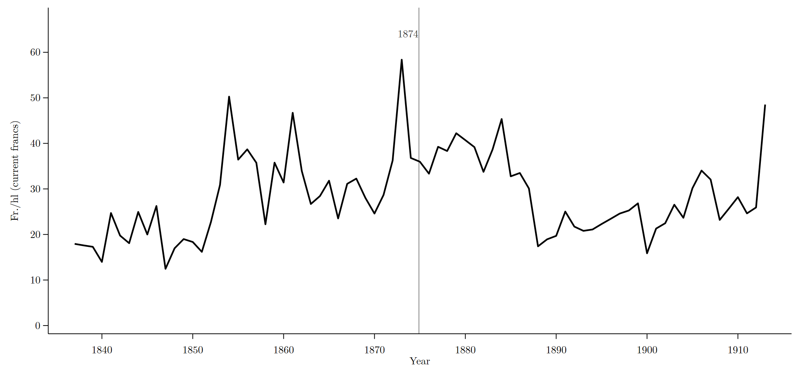

*Working paper · with [Nicholas A. Jensen](https://nicholas-jensen.com/) (Wabash College)*

[Download Paper (PDF)](https://www.dropbox.com/scl/fi/raukw6mvyrkvnse7dvd0f/jensen-absinthe.pdf?rlkey=9jku1wruib7ro02y3w04h2vw7&raw=1){.btn .btn-outline-primary .btn-sm}

## Abstract

> On July 5, 1908, Swiss voters wrote a ban on absinthe into their federal constitution, the first national prohibition of the drink enacted by popular vote. The temperance movement led the campaign. Deputies and historians pointed to the wine industry, which stood to gain if drinkers switched to wine, but no one has measured its part. We measure it across 25 cantons at both stages: the petition that put the ban on the ballot, and the vote. The Protestant share, our measure of organized temperance, predicts signatures per hundred eligible voters; the wine share does not. At the vote, the raw returns hide wine's part: the wine-growing cantons tended to be French-speaking, and French-speaking cantons gave the ban less support. Holding the French-speaking share fixed, a one-percentage-point higher share of national wine revenue goes with a 0.620-point higher yes-share. Both estimates are significant at five percent under all four of our small-sample inference procedures. Under the same specification, wine has no detectable effect on six unrelated ballots and is positive, at ten percent by permutation test, on the 1906 food-law referendum, where wine was again at stake. Temperance carried the petition; the wine interest appears at the ballot, as a beneficiary rather than a leader.

**JEL codes:** N43 · D72 · L66 · I18

## The question

The ban passed with 63.5 percent of the vote and carried every canton except Neuchâtel and Geneva, over the Federal Council's own recommendation to reject it. The temperance societies ran the campaign, and their case rested on "absinthism," a disease said to be distinct from ordinary drunkenness. Modern analysis finds nothing in pre-ban absinthe, at obtainable doses, that sets it apart from chronic alcohol abuse.

Contemporaries also noticed who stood to gain. Absinthe had spread as a cheap substitute for wine, and the Alcohol Administration's own expert predicted that other drinks "would take the place of the prohibited absinthe." Deputies and historians have pointed at the wine trade ever since, but no one had taken the claim to the data. This is, to our knowledge, the first quantitative analysis of the vote.

The initiative left two canton-level records. The petition that put the ban on the ballot (167,814 valid signatures, the largest count then recorded) captures organized mobilization, because signing was voluntary. The vote captures the electorate at large. We estimate each across the 25 cantons, holding the French-speaking share fixed, and check every estimate with four small-sample inference procedures, among them a Freedman–Lane permutation test.

## Preliminary results

- **The petition belonged to temperance.** Signatures per hundred eligible voters rise with the Protestant share, our measure of standing temperance organization (0.174, SE 0.065). The wine share is indistinguishable from zero.
- **The vote is where wine appears.** In the raw returns the wine–yes relationship runs the wrong way, because the wine-growing cantons were mostly French-speaking and French-speaking cantons supported the ban less. Among cantons equally French-speaking, a one-point higher share of national wine revenue goes with a **0.620-point** higher yes-share (SE 0.232).
- **Wine shows up only where wine was at stake.** On six federal ballots from 1897–1908 that had nothing to do with drink, the wine coefficient sits near zero. It turns positive again on the 1906 food-law referendum, where the wine trade had a direct stake (permutation *p* = .083).
- **The reading.** Temperance led the campaign; the wine interest followed at the ballot, where a vote could track local economic interest at little cost. The evidence supports wine as the ban's predicted beneficiary, not as a co-conspirator at the petition stage.

## Selected figures

{fig-alt="Dot-and-interval chart of the wine coefficient across ten Swiss federal referenda, 1897–1908; the six falsification votes cluster near zero and the 1908 absinthe vote is positive"}

{fig-alt="Line chart of nominal Swiss wine producer prices from 1837 to 1913 with a vertical marker at 1874"}

## Data

The canton-level dataset combines the federal returns for the 1908 vote and nine other referenda (1897–1908), the canton signature counts for the 1906–07 petition, wine harvest volume and revenue by canton, the Federal Alcohol Administration's 1907 register of absinthe houses (verified house by house against the sources), and census measures of language, confession, tavern employment, and population density.

---

**Suggested citation:** Jensen, Nicholas A., and Jacob R. Smith (2026). "Who Killed the Green Fairy? Temperance, Language, and Wine in the Swiss Absinthe Ban of 1908." Working paper.

::: {.callout-note}
Preliminary draft — comments welcome. The PDF link above always points to the latest version.
:::
