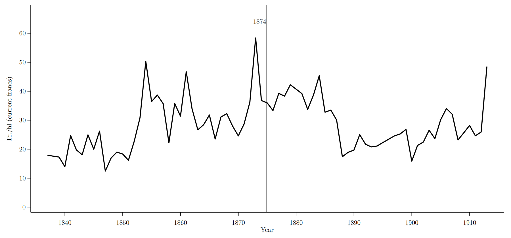

Under review, *Explorations in Economic History* · with [Nicholas A. Jensen](https://nicholas-jensen.com/) (Wabash College)

[Download Paper (PDF)](https://www.dropbox.com/scl/fi/raukw6mvyrkvnse7dvd0f/jensen-absinthe.pdf?rlkey=9jku1wruib7ro02y3w04h2vw7&raw=1){.btn .btn-outline-primary .btn-sm}

```{=html}
<style>
.jrs-poster { float: right; width: 38%; margin: 0.25rem 0 1rem 1.5rem; }
.jrs-poster figcaption { font-size: 0.8rem; }
@media (max-width: 640px) { .jrs-poster { float: none; width: 100%; margin: 1rem 0; } }
</style>
```

::: {.jrs-poster}
{fig-alt="Color poster: a black-robed figure with a blue cross on his chest and a Bible stands over a dead green woman with a small blue cross driven into her chest; ribbons and wreaths lie at her feet; caption La fin de la Fée verte"}
:::

## Abstract

> On July 5, 1908, Swiss voters wrote a ban on absinthe into their federal constitution, the first national prohibition of the drink enacted by popular vote. The temperance movement led the campaign. Deputies and historians also pointed to the wine industry, which stood to gain, but no one has measured its part. We measure it with each canton's share of the country's estimated wine revenue, across 25 cantons and at both stages of the initiative, the petition and the vote. At the petition, the Protestant share, our measure of organized temperance, predicts signatures per hundred eligible voters, and no relationship with the wine share is detectable. At the vote, language masks wine: most of the country's wine was grown in French-speaking cantons, and those cantons gave the ban less support. In the primary specification, which holds language fixed among other controls, a one-percentage-point higher wine share is associated with a 0.677-percentage-point higher yes share, significant at five percent under four small-sample procedures. On the other federal ballots we study, the wine share predicts support only once, in the 1906 vote on the federal food law, an act that protected wine. Because direct democracy separates setting the agenda from deciding it, the case measures both partners of the coalition that theories of interest-group regulation describe: temperance carried the petition, and the wine interest, which never took the podium, registered at the ballot box.

**JEL codes:** N43 · D72 · L66 · I18 · **Keywords:** absinthe prohibition, temperance, direct democracy, wine industry, interest groups, regulation, Switzerland

## Highlights

- To our knowledge, the first quantitative study of the 1908 Swiss absinthe vote
- Organized temperance, not wine, is detectable in signatures on the ban petition
- French-speaking cantons grew most Swiss wine yet gave the ban less support
- Holding language fixed, wine revenue share predicts more support at the vote
- Wine predicts no unrelated ballot and only one of three wine ballots, weakly

## The question

The ban passed with 63.5 percent of the vote and carried every canton except Neuchâtel and Geneva, over the Federal Council's own recommendation to reject it. The temperance societies ran the campaign, and their case rested on "absinthism," a disease said to be distinct from ordinary drunkenness. Modern analysis finds nothing in pre-ban absinthe, at obtainable doses, that sets it apart from chronic alcohol abuse.

Contemporaries also noticed who stood to gain. Absinthe had spread as a cheap substitute for wine, and the Alcohol Administration's own expert predicted that other drinks "would take the place of the prohibited absinthe." Deputies and historians have pointed at the wine trade ever since, but no one had taken the claim to the data.

{fig-alt="Line chart of nominal Swiss wine producer prices from 1837 to 1913 with a vertical marker at 1874"}

## Two stages, two records

A Swiss popular initiative leaves two canton-level records. The petition that put the ban on the ballot (167,814 valid signatures, the largest count then recorded) captures organized mobilization, because signing was voluntary. The vote captures the electorate at large. Because direct democracy separates setting the agenda from deciding it, the two records let us ask who did each. We estimate both across the 25 cantons and check every estimate under four small-sample inference procedures: HC3, Bell–McCaffrey, the wild bootstrap, and a Freedman–Lane permutation test.

## Findings

- **The petition belonged to temperance.** Signatures per hundred eligible voters rise with the Protestant share, our proxy for organized temperance (0.170, SE 0.056), and all four procedures reject at five percent. The wine share enters at −0.142 (SE 0.603), significant under none of them. Neither result turns on a single canton.
- **At the vote, language masks wine.** Across all 25 cantons the raw wine–yes slope runs the wrong way (−0.196, SE 0.219), because the wine-growing cantons were mostly French-speaking and French-speaking cantons supported the ban less.
- **Holding language fixed, wine predicts support.** In the primary specification a one-point higher share of national wine revenue goes with a **0.677-point** higher yes share (SE 0.216): *p* = .005 on HC3, .014 under Bell–McCaffrey, .032 on the wild bootstrap and .012 by permutation. Dropping each canton in turn leaves the coefficient between 0.598 (without Neuchâtel) and 0.801 (without Fribourg).
- **Wine shows up only where wine was at stake.** Under the same specification the wine share predicts nothing on six unrelated federal ballots from 1897–1908. Among the wine-relevant ballots it turns up once, weakly, in the June 1906 vote on the federal food law, an act that protected wine.
- **The reading.** Temperance carried the petition, and the wine interest, which never took the podium, registered at the ballot box: the case measures both partners of the coalition that theories of interest-group regulation describe.

## Selected figures

{fig-alt="Four scatter panels by canton relating wine revenue share, French-speaking share, petition signatures and the 1908 yes-share"}

{fig-alt="Dot-and-interval chart of the wine coefficient across ten Swiss federal referenda, 1897–1908; the unrelated votes cluster near zero and the 1908 absinthe vote is positive"}

{fig-alt="Forest plot of the wine coefficient with each of the 25 cantons left out in turn; all estimates stay between about 0.6 and 0.8"}

## Data

The canton-level dataset combines the federal returns for the 1908 vote and nine other referenda (1897–1908), the canton signature counts for the 1906–07 petition, wine harvest volume and revenue by canton, the Federal Alcohol Administration's 1907 register of absinthe houses (verified house by house against the sources), and census measures of language, confession, tavern employment, and population density.

---

**Suggested citation:** Jensen, Nicholas A., and Jacob R. Smith (2026). "Who Killed the Green Fairy? Temperance, Language, and Wine in the Swiss Absinthe Ban of 1908." Working paper, under review at *Explorations in Economic History*.

::: {.callout-note}
Comments welcome. The PDF link above always points to the latest version.
:::
