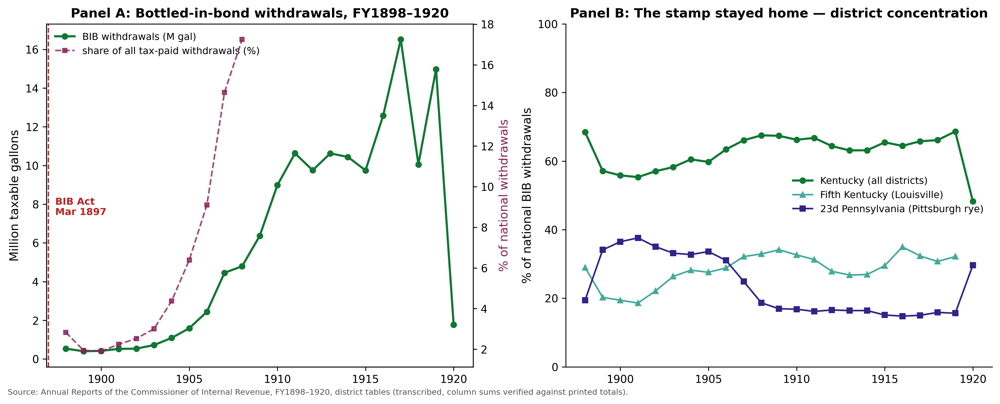

*Job market paper · sole-authored*

**Winner of the 2026 Society for the Development of Austrian Economics Graduate Student Essay Contest.** To be presented in the contest winners session at the Southern Economic Association Annual Meeting, Houston, November 22, 2026.

[Download Paper (PDF)](../Smith_Jacob_JMP.pdf){.btn .btn-outline-primary .btn-sm}

## Overview

The Bottled-in-Bond Act of 1897 is usually remembered as one of America's first consumer-protection laws — a federal guarantee, in an age of rampant adulteration, that what the label promised was what the bottle held. This paper reads the Act through public choice instead: as a government-administered solution to a credence-goods problem the straight distillers of Kentucky and Pennsylvania could not solve privately. Their brands and marks were freely counterfeited down a distribution chain they could not police; a Treasury strip stamp, backed by federal criminal law, made their quality signal excludable in a way no private mark ever had.

The reframing yields a sharp, testable distinction. If the Act worked by **raising rivals' costs**, certified output should have grown at the expense of the rectifiers (blenders of cheaper neutral spirit) and a scarcity rent should have opened in relative prices. If it worked by **certifying quality**, a new premium tier should have grown from a near-zero base *without* the rectifying trade falling. The two mechanisms make opposite predictions — and the data can tell them apart.

The evidence comes from a **newly digitized state-by-fiscal-year panel built from the Annual Reports of the Commissioner of Internal Revenue, FY1877–1920** — whiskey deposited into bond, tax-paid withdrawals, spirits rectified, distilleries operated, grain consumed, and (after 1897) withdrawals under the bottled-in-bond stamp — validated against the printed totals through 459 cross-year chain assertions and 59 zero-tolerance national control totals.

## Abstract

> "The Bottled-in-Bond Act of 1897 created a federal strip stamp certifying single-distillery, single-season whiskey aged at least four years in bond. In 1893 a revenue official had proposed, and a House committee endorsed, a cheap stamp for every bottle, marking original packages and compounds alike. The Act confined the stamp to four-year whiskey. On newly digitized Internal Revenue accounts by state and year, rectified output rose 43 percent after the Act and did not fall relative to straight output. If the years just before the Act are a valid baseline, the design rules out a relative contraction of the rectifying trade above about 15 percent. The Act instead created a certified segment, fast-growing after 1902 amid a cultivated demand campaign and drawn in Kentucky and Pennsylvania in proportion to their stocks in bond. That fits a neutral rule too. The capture lies in the eligibility term, a four-year floor where a printed date would have answered deception. Capture can be identified by whom eligibility was written around, not only by rivals’ losses."

## A preview of the findings

**1. No foreclosure.** Foreclosure predicts that the within-state gap between straight and rectified output shifts toward straight whiskey after 1897. It did not: national rectified output averaged **43 percent more** after the Act than before, and the gap did not move toward straight whiskey. If the years just before the Act are a valid baseline, the difference-in-differences **rules out a relative contraction of the rectifying trade larger than about 15 percent**. The trade the bill's proponents complained of kept growing.

**2. A manufactured premium segment.** The genuine expansion is the certified sub-segment itself: bottled-in-bond withdrawals grew from **0.54 million gallons in 1898 to 4.79 million by 1908** — flat through FY1902, then accelerating sharply as demand was cultivated — reaching about 3 percent of straight output by 1905, a small tier expanding on top of an existing trade. Whether that volume was new or relabeled, the quantity record cannot settle: within adopting states the elasticity of non-bonded on bonded withdrawals is **−0.096 (standard error 0.108; ten states)**, and its interval covers both zero and the band that one-for-one relabeling implies. Prices are the weak record. A hedonic model of roughly two hundred hand-collected quotes puts bonded whiskey **about 10 percent** above rectified spirits, conditional on age and channel, but that gap combines the federal mark with the straight–rectified quality difference; against uncertified straight whiskey the bonded premium is about two percent, well inside its standard error. The price difference-in-differences the quotes allow is uninformative, and the price evidence is read as illustrative and bounding.

**3. Capture by eligibility.** Kentucky and Pennsylvania together took **92 percent of bonded bourbon and rye withdrawals**, roughly in proportion to the whiskey they already held in bond; Kentucky's share of bonded withdrawals equals its share of aged stocks in bond at **0.99×**. Proportional uptake fits a neutral rule too, so the capture is not in who used the stamp but in who was eligible for it. In 1893 the Deputy Commissioner of Internal Revenue proposed, and a House committee endorsed, a cheap stamp for *every* bottle that would have told buyers whether it came from a distiller's original package or was compounded. The Act kept the stamp and confined it to whiskey four years old. A printed date would have answered the deception the distillers complained of; a four-year floor wrote eligibility around the aged stock the incumbents already held. The demand for certified whiskey was then actively cultivated, with Harvey Wiley's federal purity chemists lending their authority to teach buyers to distrust uncertified spirit.

The upshot: **capture need not look like foreclosure.** A regulation can expand a market, resolve a real information asymmetry, and still be capture, identified by whom its eligibility rule was written around.

## Bonded whiskey withdrawals by state, 1898–1920

Hover any line to read the exact figure — the certification was overwhelmingly a Kentucky (and Pennsylvania) phenomenon.

```{ojs}
//| echo: false
bibdata = d3.csvParse(`fy,state,bib_gal
1898,IL,29792
1898,IN,3695
1898,KY,366622
1898,OH,16290
1898,PA,108852
1899,IL,16267
1899,IN,779
1899,KY,228614
1899,OH,3825
1899,PA,140354
1900,IL,16769
1900,IN,1049
1900,KY,234914
1900,OH,7512
1900,PA,156277
1901,IL,21526
1901,IN,6999
1901,KY,288358
1901,OH,5549
1901,PA,198172
1902,IL,29163
1902,IN,5754
1902,KY,305220
1902,OH,6710
1902,PA,188137
1903,IL,38858
1903,IN,5665
1903,KY,418530
1903,OH,16364
1903,PA,238736
1904,IL,44209
1904,IN,6298
1904,KY,657856
1904,OH,19960
1904,PA,356339
1905,IL,50156
1905,IN,10362
1905,KY,949751
1905,OH,29235
1905,PA,538237
1906,IL,63010
1906,IN,12166
1906,KY,1547093
1906,OH,33132
1906,PA,761699
1907,IL,85983
1907,IN,25684
1907,KY,2942260
1907,MO,5712
1907,OH,202842
1907,PA,1122255
1908,IL,95289
1908,IN,49335
1908,KY,3236470
1908,MO,17355
1908,OH,387822
1908,PA,921612
1909,IL,228788
1909,IN,68933
1909,KY,4288326
1909,MO,68972
1909,OH,471965
1909,PA,1114639
1910,IL,368282
1910,IN,88726
1910,KY,5950277
1910,MO,90179
1910,OH,795664
1910,PA,1548983
1911,IL,559046
1911,IN,102312
1911,KY,7095958
1911,MO,104016
1911,OH,756218
1911,PA,1781855
1912,IL,445870
1912,IN,117300
1912,KY,6277845
1912,MO,61851
1912,OH,829740
1912,PA,1686498
1913,IL,621964
1913,IN,149676
1913,KY,6706756
1913,MO,45071
1913,OH,952206
1913,PA,1805902
1914,IL,660226
1914,IN,162442
1914,KY,6593926
1914,MO,30837
1914,OH,966116
1914,PA,1757810
1915,IL,602720
1915,IN,216139
1915,KY,6381863
1915,MO,37780
1915,OH,787935
1915,PA,1499255
1916,IL,811244
1916,IN,361497
1916,KY,8104846
1916,MO,59166
1916,OH,1044003
1916,PA,1910709
1917,IL,942554
1917,IN,320259
1917,KY,10858233
1917,MO,104072
1917,OH,1391836
1917,PA,2582600
1918,IL,630848
1918,IN,182757
1918,KY,6648240
1918,MO,32062
1918,OH,754708
1918,PA,1677916
1919,IL,781131
1919,IN,237899
1919,KY,10274290
1919,MO,30706
1919,OH,1068483
1919,PA,2389728
1920,IL,170234
1920,IN,17001
1920,KY,854520
1920,MO,2796
1920,OH,30155
1920,PA,529473`, d3.autoType)
```

```{ojs}
//| echo: false
Plot.plot({
  marginLeft: 66,
  height: 380,
  x: {label: "Fiscal year", tickFormat: "d"},
  y: {label: "Gallons withdrawn", grid: true, tickFormat: "~s"},
  color: {legend: true},
  marks: [
    Plot.ruleY([0]),
    Plot.line(bibdata, {x: "fy", y: "bib_gal", z: "state", stroke: "state", strokeWidth: 2, curve: "catmull-rom"}),
    Plot.dot(bibdata, Plot.pointer({x: "fy", y: "bib_gal", stroke: "state", r: 4})),
    Plot.tip(bibdata, Plot.pointer({x: "fy", y: "bib_gal", title: (d) => `${d.state} · FY${d.fy}\n${d.bib_gal.toLocaleString()} gallons`}))
  ]
})
```

## Selected figures

{fig-alt="Line chart of national bottled-in-bond withdrawals rising from 0.54 to 16.51 million gallons, 1898–1917, with Kentucky and Pennsylvania supplying most of the volume"}

{fig-alt="Chart comparing the small but fast-growing bonded sub-segment with the much larger straight and rectified output series"}

{fig-alt="Event-study coefficients and indexed output series showing no post-Act divergence in favor of straight whiskey"}

## Key estimate

**Hedonic price model** (log price per proof gallon; rectified spirits the omitted category; channel, state, and year fixed effects):

| Variable | Coefficient | Std. error |
|---|---:|---:|
| Bottled-in-bond | +0.096 | 0.058 |
| Straight (uncertified) | +0.076 | 0.088 |
| Age (per year) | +0.074 | 0.009 |

N = 187; R² = 0.66. Standard errors clustered by source advertisement. No significance stars, following the paper: the quotes come from six states. The bonded coefficient combines the federal mark with the straight–rectified quality difference; the certification contrast (bonded minus straight) is about 0.02 log points. Illustrative and bounding; stable across real-price and high-confidence-quote specifications.

---

**JEL codes:** N41 · L51 · L15 · D72 · D82 · K23

**Keywords:** bottled-in-bond, regulatory capture, rent-seeking, credence goods, certification, whiskey

**Suggested citation:** Smith, Jacob R. (2026). "Distillers and Chemists: Capture by Eligibility in the Bottled-in-Bond Act of 1897." Working paper, Middle Tennessee State University.

::: {.callout-note}
This page is a preview. The full paper — including the common-treatment-date event study, the relabeling test, the legislative and archival record on intent (the committee report, the Aldrich "or owner" amendment, the organized rectifier remonstrances), and the complete robustness battery — is [available as a PDF](../Smith_Jacob_JMP.pdf).
:::
