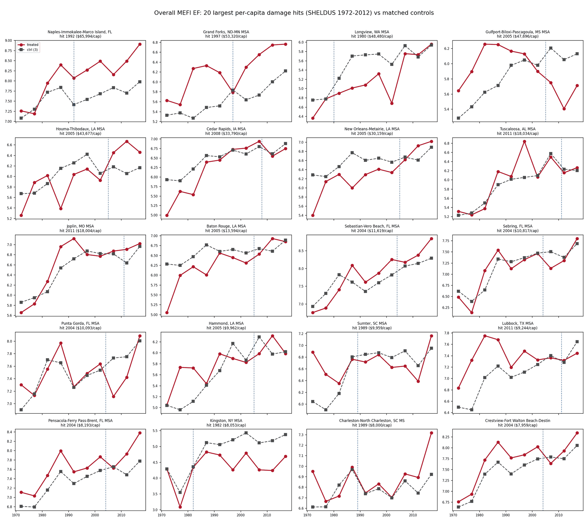

*Working paper · sole-authored*

## Overview

Robert Higgs's *Crisis and Leviathan* argues that emergencies permanently enlarge government: a crisis legitimates new spending, agencies, and powers; the crisis passes; the government stays. The evidence for the ratchet is federal — war, depression, the New Deal — and in every one of those episodes the government doing the growing was a monopoly its citizens could not escape.

This paper asks whether the ratchet survives the removal of that condition. Metropolitan governments face real emergencies, but they face them with residents who can move across the county line and with disaster money that arrives largely from Washington. If the ratchet is a general property of government under stress, it should appear here too. If it is a property of *insulation from exit*, it should vanish.

The test uses natural disasters as locality-specific crises, linking county-level losses from **SHELDUS (1960–2012)** to the **U.S. Metropolitan Area Economic Freedom Index** — the metropolitan extension of the Fraser Institute's Economic Freedom of North America index — across **383 metropolitan areas over ten waves, 1972–2017**. A large hit is a metro's first year with at least **$2,000 per resident** in real damage, which yields **83 treated metros** across nine event cohorts. The twenty largest hits alone span eleven distinct disasters across five decades: Katrina and New Orleans, Andrew and Naples, the Grand Forks flood, Mount St. Helens, Joplin.

## Abstract

> "Higgs's ratchet hypothesis holds that crises permanently enlarge government. I test it at the level of American government where exit is cheapest: the metropolitan area. I link county-level natural-disaster losses (SHELDUS, 1960–2012) to the U.S. Metropolitan Area Economic Freedom Index, the metropolitan extension of the Fraser Institute's Economic Freedom of North America index, covering 383 metropolitan areas over ten waves (1972–2017). Stacked event-study regressions compare the 83 metros hit by large disasters — at least \$2,000 per resident in real damage — to never-hit metros. Within states, disaster-struck metros show no decline in economic freedom at any horizon: the post-event effect is 0.003 index points (SE 0.047), precise enough to rule out losses larger than 0.13 points, about a sixth of the cross-metro standard deviation. Government spending rises after disasters, but only in step with a rebuilding income boom, and both revert. Crisis does not grow local Leviathan."

## Headline findings

- **No ratchet within states.** Against unhit metros in the same state, the post-event effect on overall economic freedom is **+0.003 index points** (SE 0.047) — a zero under clustered inference (*p* = 0.94), randomization inference (*p* = 0.90), and a wild-cluster bootstrap (*p* = 0.95).
- **The null is informative, not underpowered.** At 80 percent power the design detects a decline of **0.133 points**: one-sixth of the cross-metro standard deviation, and nearly two-fifths of a typical five-year within-metro change.
- **The naive comparison finds a ratchet, and its own pre-trends reject it.** Compared to unhit metros anywhere, the effect is **−0.121** (*p* = 0.09; randomization inference *p* = 0.003) — but treated metros already sit **+0.164** and **+0.131** points *above* their controls three and two waves before the disaster.
- **On the spending margin, less precision.** Area 1, where a ratchet ought to concentrate, gives **+0.028** (SE 0.093) against a minimum detectable decline near **0.26 points**. That rules out large spending ratchets, not small ones.

## The event study

Event-time coefficients under both comparisons. Hover any point for the coefficient and its standard error; bars are 95 percent confidence intervals, standard errors clustered by state.

```{ojs}
//| echo: false
es = d3.csvParse(`spec,tau,coef,se
Cross-state (wave FE),-3,0.164,0.101
Cross-state (wave FE),-2,0.131,0.065
Cross-state (wave FE),-1,0.039,0.035
Cross-state (wave FE),0,0,0
Cross-state (wave FE),1,-0.050,0.058
Cross-state (wave FE),2,-0.017,0.059
Cross-state (wave FE),3,-0.080,0.071
Within-state (state×wave FE),-3,0.014,0.042
Within-state (state×wave FE),-2,0.028,0.051
Within-state (state×wave FE),-1,-0.015,0.022
Within-state (state×wave FE),0,0,0
Within-state (state×wave FE),1,0.001,0.026
Within-state (state×wave FE),2,-0.010,0.035
Within-state (state×wave FE),3,0.043,0.056`, d3.autoType)
```

```{ojs}
//| echo: false
Plot.plot({
  height: 360,
  marginLeft: 58,
  marginRight: 16,
  x: {label: "Event time (5-year waves)", tickFormat: "d", ticks: 7},
  y: {label: "Overall EF: treated − control", grid: true, domain: [-0.28, 0.40]},
  color: {domain: ["Cross-state (wave FE)", "Within-state (state×wave FE)"], range: ["#9AA0A6", "#007BC3"], legend: false},
  fx: {label: null},
  marks: [
    Plot.ruleY([0], {stroke: "#666", strokeWidth: 1}),
    Plot.ruleX([0], {stroke: "#bbb", strokeDasharray: "2,3"}),
    Plot.ruleX(es, {fx: "spec", x: "tau", y1: d => d.coef - 1.96 * d.se, y2: d => d.coef + 1.96 * d.se, stroke: "spec", strokeWidth: 1.4}),
    Plot.line(es, {fx: "spec", x: "tau", y: "coef", stroke: "spec", strokeWidth: 2}),
    Plot.dot(es, {fx: "spec", x: "tau", y: "coef", fill: "spec", r: 4.5}),
    Plot.tip(es, Plot.pointer({fx: "spec", x: "tau", y: "coef", title: d => `τ${d.tau > 0 ? "+" : ""}${d.tau}\n${d.coef >= 0 ? "+" : ""}${d.coef.toFixed(3)} (SE ${d.se.toFixed(3)})`}))
  ]
})
```

Left is the selection problem; right is the answer. Disaster-exposed metros are coastal, southern, and riverine, and they sit in states whose institutional standing was already drifting for reasons that predate any storm. State-by-wave effects absorb those trajectories and the gap collapses to zero.

## Mechanism

Relief spending is real and shows up in the raw data. So does the rebuilding boom that pays for it. Among the twenty hardest-hit metros, treated-minus-control gaps move as follows from the last pre-event wave to the wave after the hit:

```{ojs}
//| echo: false
mech = d3.csvParse(`series,logpts
Real government consumption,5.5
Real personal income,4.8
Population,-1.9
Government spending ÷ income (what the index scores),0.3`, d3.autoType)
```

```{ojs}
//| echo: false
Plot.plot({
  marginLeft: 265,
  marginRight: 40,
  height: 240,
  x: {label: "Change in treated − control gap, τ0 → τ+1 (log points)", grid: true},
  y: {label: null},
  marks: [
    Plot.ruleX([0], {stroke: "#666"}),
    Plot.barX(mech, {y: "series", x: "logpts", fill: d => d.logpts < 0 ? "#B3182C" : "#007BC3"}),
    Plot.text(mech.filter(d => d.logpts >= 0), {y: "series", x: "logpts", text: d => "+" + d.logpts, dx: 18, fontSize: 11}),
    Plot.text(mech.filter(d => d.logpts < 0), {y: "series", x: "logpts", text: d => String(d.logpts), dx: -18, fontSize: 11}),
    Plot.tip(mech, Plot.pointerY({y: "series", x: "logpts", format: {x: d => (d > 0 ? "+" : "") + d + " log points"}}))
  ]
})
```

Spending and income move together, so government's share of the local economy — the ratio the index actually scores — does not move at all. The surge is federally financed, the rebuilding is private, and real income per capita ends 6.6 log points higher three waves out.

## The raw data

{fig-alt="Twenty small-multiple line charts of metropolitan economic freedom for the hardest-hit metros against matched controls"}

## Robustness

| Specification | Post-event effect | SE | *p* |
|---|---:|---:|---:|
| Baseline (within-state) | +0.003 | 0.047 | 0.94 |
| Baseline, Area 1 (government spending) | +0.028 | 0.093 | 0.76 |
| Damage cutoff $1,000/capita (124 treated) | −0.007 | 0.045 | 0.87 |
| Damage cutoff $5,000/capita (31 treated) | −0.005 | 0.051 | 0.92 |
| Drop the 2002 cohort (Katrina, 2004 Florida) | +0.007 | 0.053 | 0.89 |
| Drop the 2007 and 2012 cohorts | +0.033 | 0.050 | 0.51 |
| Pre-1997 cohorts only | −0.003 | 0.039 | 0.94 |
| Drop 14 serially hit metros | +0.003 | 0.055 | 0.96 |
| Exclude same-CSA controls (spillovers) | −0.006 | 0.041 | 0.89 |
| Callaway–Sant'Anna, state-by-wave-demeaned | −0.016 | 0.018 | 0.37 |
| Raw ratio outcome (log spending ÷ income) | +0.008 | 0.025 | 0.75 |

Estimator choice does not matter: Callaway–Sant'Anna group-time estimates with never-treated controls reproduce the stacked results in both comparisons, pre-trends included. Neither does the index's construction — replacing the score with the raw log ratio of government consumption to personal income bypasses the within-wave renormalization and gives the same zero. Because SHELDUS ends in 2012, FEMA obligations check the control group for late contamination: exactly one control metro crosses $500 per capita in 2013–2017, and dropping it leaves the estimate unchanged.

## What the finding does and does not say

The result disciplines the ratchet hypothesis rather than refuting it. Higgs built the ratchet on a monopoly government meeting a national emergency with nowhere for its citizens to go. Metropolitan governments have neither feature: the money is largely federal, and the residents who would pay for a permanently larger local state can leave. Under exit and external finance, crisis produces no ratchet — which points to insulation from competition, not government as such, as the operative condition. The next test sits one level up, where insulation is intermediate: state governments, measurable with the state-level index back to 1981 and with historical fiscal data before that.

---

**JEL codes:** D72 · H11 · H77 · Q54 · R11

**Keywords:** economic freedom, natural disasters, ratchet effect, Leviathan, local government

**Suggested citation:** Smith, Jacob R. (2026). "Crisis and Local Leviathan: Natural Disasters and Economic Freedom in U.S. Metropolitan Areas, 1972–2017." Working paper, Middle Tennessee State University.

::: {.callout-note}
This page is a preview of a July 2026 workshop draft. The full paper — including the identification strategy, the complete inference battery, and the power analysis behind the minimum detectable effect — is available on request at [jrs2ge@mtmail.mtsu.edu](mailto:jrs2ge@mtmail.mtsu.edu).
:::
